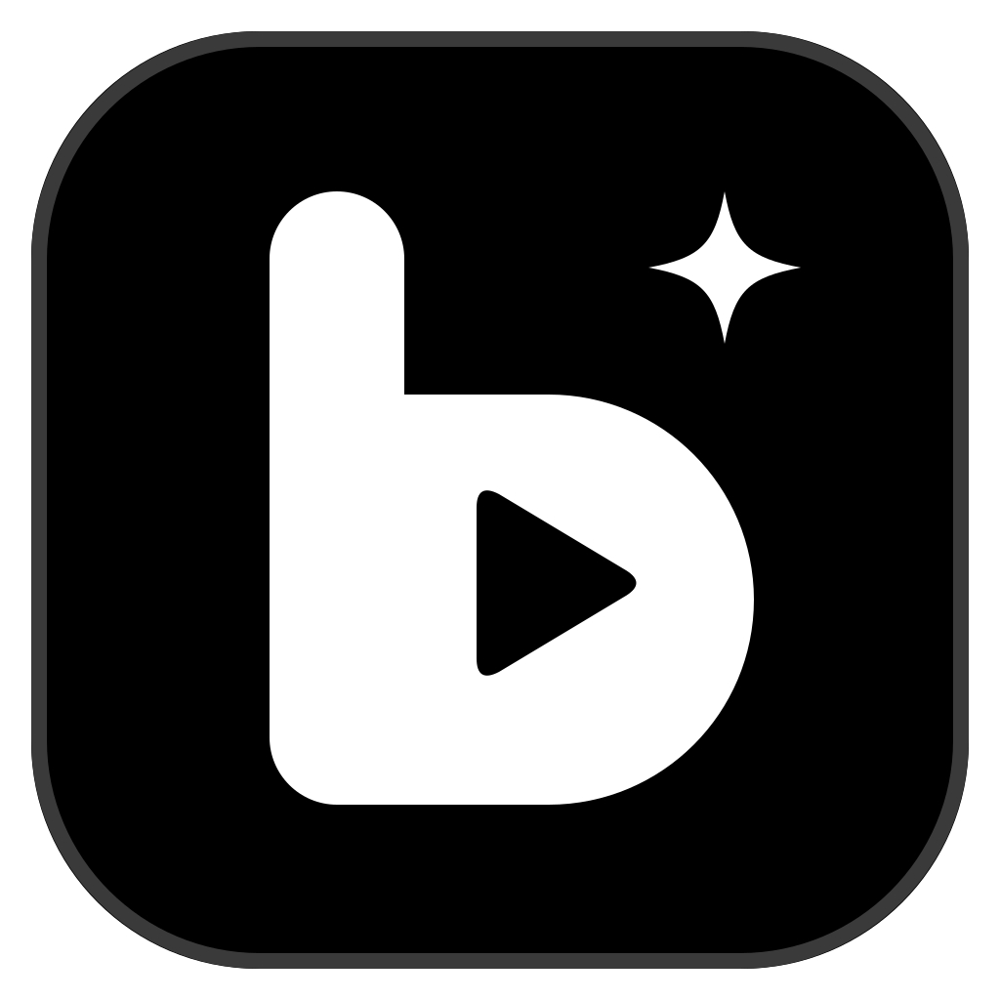

<p align="center"></p>

<h1 align="center">Bouteca</h1>
<p align="center">Buscador de memes, GIFs, videos, imágenes, sonidos y música para Windows.<br>
Bout + biblioteca: escribí lo que necesitás, previsualizalo y descargalo, todo en un lugar.</p>

---

## Qué hace

- **Busca en 16 fuentes oficiales a la vez**: 10 sin clave (Wikimedia Commons, Openverse,
  Internet Archive, Imgflip, NASA, Art Institute of Chicago, The Met, Cleveland Museum of Art,
  iNaturalist y PeerTube) y 6 con clave (GIPHY, KLIPY, YouTube, Freesound, Pixabay y Pexels),
  que funcionan a través del servicio de Bouteca o con tu propia clave gratuita. No cubre "todo
  Internet": solo fuentes con API oficial que se pueden ver o escuchar de verdad (detalle y
  fuentes retiradas en `PROVIDERS.md`).
- **Memes o Archivo, según lo que buscás:** "pepe sad" va a memes y reacciones; "pepe the frog
  history", "museos" o "naturaleza" van a material documental. Se puede cambiar con un toque.
- **Orden:** lo mejor (relevancia + vistas + actualidad + clips cortos), tendencias, más
  recientes, más populares o relevancia, con datos reales de cada fuente.
- **Música** como sección propia: pedidos en lenguaje natural ("música de tensión para un video
  de terror sin atribución"), filtros de derechos (sin atribución, con atribución, licencia
  comercial, uso restringido) y de uso (YouTube, monetizado, TikTok/Instagram, streams, juegos,
  películas, comercial), créditos listos para copiar.
- **Derechos claros en cada resultado**: indicador, resumen en lenguaje simple, compatibilidad
  por uso. Una licencia desconocida nunca se trata como permiso: se puede ver, no descargar.
- **Sin duplicados**: el mismo contenido de varias fuentes se agrupa en una tarjeta con sus
  versiones (otras fuentes, GIF/video, otra duración), eligiendo la de mejor calidad.
- **Calidades reales** (Original/Alta/Media/Baja solo si la fuente las publica) y calidad preferida.
- **Bouteca Studio**: una sección aparte para armar kits por proyecto (música, efectos, videos e
  imágenes) con créditos del kit; nunca interfiere con la búsqueda normal.
- **Actualizaciones firmadas e integradas:** al abrir, Bouteca se fija si hay una versión
  nueva; la descarga y verificación se ven dentro de la app y la instalación es silenciosa,
  con reapertura automática. "Actualizar ahora" o "Más tarde" (te la vuelve a ofrecer en 24 h).
- **YouTube en Videos:** buscá y reproducí con el reproductor oficial. YouTube no permite
  descargar desde apps de terceros: Bouteca ofrece guardar, copiar el enlace o abrirlo en YouTube.
- **Búsqueda por imagen:** arrastrá, pegá o elegí una imagen y Bouteca ordena los resultados por
  parecido. Se calcula en tu equipo: la imagen no se envía a ningún servicio.
- **Entiende tu idioma:** escribís en español y Bouteca también busca en inglés (y en portugués,
  turco, japonés o ruso si lo activás). Reconoce sinónimos y personajes conocidos
  ("bob esponja", "tipo amarillo", "coffin dance") y memes aunque estén mal escritos
  ("peppo cry" → Pepe the Frog llorando).
- **Clips cortos primero:** elegí la duración (muy cortos, 30 s, 1, 5 o 10 minutos, o cualquiera);
  los resultados recientes suben en el orden.
- **Navegación como en el navegador:** atrás/adelante (Alt+←/→ o los botones del mouse) conserva
  resultados, filtros y posición.
- **Resultados progresivos:** cada fuente aparece apenas responde; una fuente caída no frena a las demás.
- **Previsualización integrada** de videos, GIFs, imágenes y audios, sin abrir ventanas.
- **Descargas en un clic** (con pausa y reanudación, y calidad elegible aparte), validadas, sin
  duplicados y organizadas en `Descargas\Bouteca\{Videos, GIFs, Audios, Imágenes}`. Desde
  Descargas podés borrar archivos (con confirmación) o solo quitarlos de la lista; la lista se
  sincroniza sola con la carpeta.
- **Copiar imagen** al portapapeles para pegarla en Discord, OBS o un editor.
- **Favoritos, colecciones e historial** guardados solo en tu equipo.
- **Liviana y prolija:** cuadrícula virtualizada, modo inactivo, autolimpieza de temporales y
  caché con límite. Sin publicidad ni telemetría.
- **Integración con Windows:** atajo global (`Ctrl+Shift+B`), bandeja opcional, inicio con
  Windows opcional, una sola instancia.

## Instalación (usuario)

1. Descargá `Bouteca_<versión>_x64-setup.exe` desde la última versión publicada:
   https://github.com/bouthex/bouteca/releases/latest (junto está `SHA256SUMS.txt`).
2. Ejecutalo. Se instala para tu usuario, sin permisos de administrador. Si el equipo no tiene
   WebView2 (Windows 10 muy antiguos), el instalador lo descarga.
3. Abrí Bouteca y buscá. Opcional: en **Ajustes → Fuentes** pegá claves gratuitas para sumar
   GIPHY, KLIPY, YouTube, Freesound, Pixabay y Pexels (cada fila tiene el botón "Conseguir clave").

Windows puede mostrar el aviso de SmartScreen "editor desconocido" porque el instalador todavía
no tiene firma de código (Authenticode). Elegí "Más información → Ejecutar de todas formas".
Podés comparar el SHA-256 con `SHA256SUMS.txt` de la release. Las actualizaciones automáticas,
en cambio, sí se verifican siempre con la firma del proyecto.

### Claves de API (todas gratuitas)

| Fuente | Dónde se obtiene |
|---|---|
| GIPHY | developers.giphy.com → Create an App → API |
| KLIPY | partner.klipy.com → crear app → API key |
| YouTube | console.cloud.google.com → nuevo proyecto → habilitar "YouTube Data API v3" → Credenciales → Clave de API (recomendado: restringirla a esa API) |
| Freesound | freesound.org/apiv2/apply |
| Pixabay | pixabay.com/api/docs (con sesión iniciada) |
| Pexels | pexels.com/api/new |

Las claves se guardan en el Administrador de credenciales de Windows y nunca se muestran
completas. **Un secreto de GitHub no llega a la app instalada**: en tu PC tenés que pegar la clave
en Ajustes → Fuentes. Sin una clave, esa fuente simplemente no participa y el resto funciona.
Para probarlas en CI, cargalas como *secrets* del repositorio con los nombres
`BOUTECA_KEY_GIPHY`, `BOUTECA_KEY_KLIPY`, `BOUTECA_KEY_YOUTUBE`, `BOUTECA_KEY_FREESOUND`,
`BOUTECA_KEY_PIXABAY`, `BOUTECA_KEY_PEXELS`.

**Actualizar:** Bouteca busca versiones nuevas al abrirse (canal estable por defecto; beta
opcional en Ajustes → Actualizaciones), las descarga en segundo plano, verifica la firma y te
muestra "Reiniciar y actualizar". Nunca instala sin tu confirmación. Tu configuración,
favoritos, colecciones, proyectos de Studio e historial se conservan.

**Desinstalar:** Configuración de Windows → Aplicaciones → Bouteca. Tus archivos descargados no se borran.

## Desarrollo

Requisitos: Rust estable, Node 22, y en Windows las herramientas de compilación de C++ de Visual Studio.

```bash
cd ui && npm ci && cd ..
cargo test -p bouteca-core          # núcleo
(cd ui && npm test)                 # lógica de la interfaz
node ui/node_modules/@tauri-apps/cli/tauri.js dev     # app en modo desarrollo
node ui/node_modules/@tauri-apps/cli/tauri.js build   # instalador (en Windows)
```

Estructura:

```
crates/bouteca-core/   motor: proveedores, búsqueda, biblioteca, descargas, mantenimiento
src-tauri/             app de escritorio (Tauri 2)
ui/                    interfaz (Preact + TypeScript)
assets/brand/          logo e icono
tools/dev-mock/        servidor simulado para pruebas visuales sin red
```

## Documentación

| Archivo | Contenido |
|---|---|
| [ARCHITECTURE.md](ARCHITECTURE.md) | Arquitectura y flujos |
| [PROVIDERS.md](PROVIDERS.md) | Fuentes, límites, claves y condiciones |
| [DECISIONS.md](DECISIONS.md) | Decisiones técnicas y motivos |
| [PERFORMANCE.md](PERFORMANCE.md) | Presupuestos de recursos y mediciones |
| [TESTING.md](TESTING.md) | Pruebas y resultados |
| [PROGRESS.md](PROGRESS.md) | Qué está hecho, probado, pendiente o bloqueado |
| [ROADMAP.md](ROADMAP.md) | Fases |
| [SECURITY.md](SECURITY.md) | Controles de seguridad, datos enviados, reporte de vulnerabilidades |
| [THREAT_MODEL.md](THREAT_MODEL.md) | Modelo de amenazas STRIDE y riesgos residuales |

## Limitaciones conocidas

Ver [PROGRESS.md](PROGRESS.md#limitaciones-conocidas).

## Respeto de derechos

Bouteca solo usa APIs oficiales, no elude DRM ni restricciones, y conserva autor, licencia y
fuente de cada descarga ("Copiar atribución"). Los contenidos de GIPHY/KLIPY pertenecen a sus
autores y se descargan para uso personal según los términos de cada proveedor.
